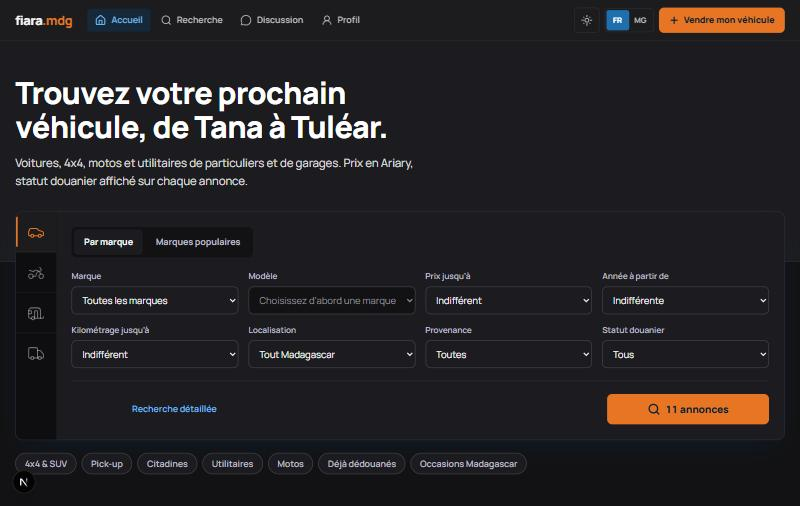
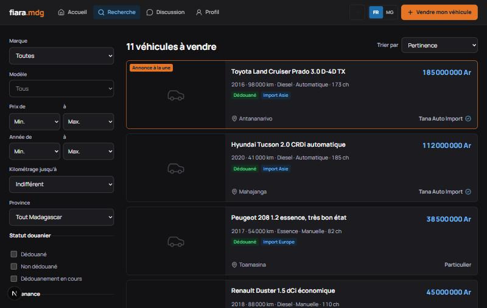
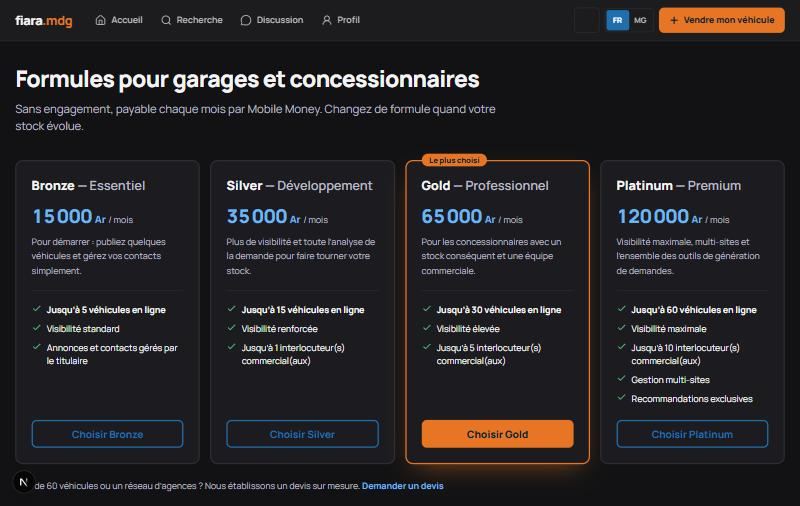

# fiara.mdg

Place de marché automobile pour Madagascar : annonces de particuliers et de garages, prix en Ariary, statut douanier affiché sur chaque véhicule, interface en français et en malgache.

*A car classifieds marketplace for Madagascar, inspired by mobile.de. Full-stack TypeScript prototype built with Next.js, Express and PostgreSQL, developed with Claude Code.*



| Recherche | Formules professionnelles |
|---|---|
|  |  |

## État du projet

**Prototype fonctionnel en local, non déployé.** Les annonces et les comptes sont des données de démonstration.

| Fonctionne | Limites actuelles |
|---|---|
| Recherche, annonces, favoris, messagerie, comptes | Aucun test automatisé pour le moment |
| Abonnements pro et droits par formule | Paiements simulés : Mobile Money à connecter, carte et PayPal en simulation sans clés |
| Vérification d'identité avec stockage chiffré | Contrôle qualité par règles, pas encore par un modèle d'IA |
| Configuration Docker prête | Déploiement non réalisé en production |

## Fonctionnalités

- **Recherche détaillée :** catégories, marque, modèle, prix, année, kilométrage, localisation, provenance et statut douanier, avec un compteur de résultats en direct.
- **Annonces :** dépôt avec photos, modification, modération et mise en avant payante.
- **Comptes :** particuliers et professionnels, favoris, alertes, historique de recherche et messagerie.
- **Espace professionnel :** 4 formules, gestion d'équipe et de sites, suivi des prospects, offres directes et statistiques.
- **Paiements :** parcours Mobile Money (MVola, Orange Money, Airtel Money), Stripe et PayPal, avec callbacks enregistrés et confirmation idempotente.
- **Adapté à Madagascar :** prix en Ariary, malgache, provinces, téléphones locaux, carte des vendeurs et provenance des véhicules.

## Technologies

| Domaine | Technologies |
|---|---|
| Frontend | Next.js (App Router), React 19, TypeScript, Tailwind CSS 4, Motion, Leaflet |
| Backend | Node.js, Express 5, TypeScript, Zod, Multer |
| Base de données | PostgreSQL, PGlite en développement, SQL versionné |
| Authentification et sécurité | JWT en cookie httpOnly, bcrypt, Helmet, chiffrement AES-256-GCM des pièces d'identité |
| Paiements | Stripe et PayPal (intégrations à activer avec des clés), Mobile Money (à connecter) |
| Déploiement préparé | Docker, Docker Compose, Caddy, sauvegardes chiffrées |

## Choix d'architecture

- **Monorepo npm :** `apps/web` pour l'interface et `apps/api` pour l'API.
- **Proxy `/bff` :** le jeton de session reste dans un cookie httpOnly, hors de portée du JavaScript du navigateur.
- **Droits stockés en base :** changer le contenu d'une formule demande une mise à jour SQL, pas une modification du code.
- **Base de données :** 33 tables, 7 fichiers de migration ; le prix de référence reste en Ariary, et le montant débité et le taux sont figés sur chaque paiement.
- **Traductions typées :** TypeScript vérifie que le français et le malgache ont les mêmes clés.

Le détail se trouve dans [docs/ARCHITECTURE.md](docs/ARCHITECTURE.md) et [docs/HEBERGEMENT.md](docs/HEBERGEMENT.md).

## Lancer le projet

Prérequis : Node.js et npm.

```bash
npm install
npm run db:migrate
npm run dev:api
npm run dev:web
```

Lancez `dev:api` et `dev:web` dans deux terminaux, puis ouvrez http://localhost:3000. Aucune installation de PostgreSQL n'est nécessaire en développement : sans `DATABASE_URL`, l'API utilise PGlite.

Comptes de démonstration, avec le mot de passe `fiara2026` :

| Compte | Rôle |
|---|---|
| `garage@fiara.mg` | Professionnel, formule Gold |
| `commercial@fiara.mg` | Commercial du garage |
| `tiana@fiara.mg` | Acheteuse |
| `vola@fiara.mg` | Vendeuse particulière |
| `admin@fiara.mg` | Modération |

Ces comptes servent uniquement à la démonstration locale.

## Développement avec Claude Code

J'ai réalisé ce projet en binôme avec [Claude Code](https://claude.com/claude-code), l'agent de programmation d'Anthropic. J'ai défini le produit, les fonctionnalités, les adaptations au marché malgache et l'identité visuelle, puis j'ai dirigé et validé chaque itération. Claude Code a écrit l'essentiel de l'implémentation.

## Prochaines étapes

1. Ajouter des tests automatisés sur la recherche, les droits et les paiements.
2. Connecter un premier opérateur Mobile Money.
3. Déployer une démonstration publique.
4. Remplacer le contrôle qualité par règles par un vrai modèle, et ajouter l'estimation de prix.

## Licence

Tous droits réservés. Le code est visible à titre de présentation.
